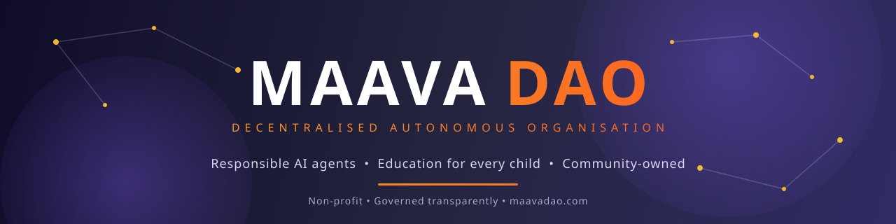

<div align="center">



### maava Community Agents

Open-source AI agents for sales, marketing and growth, customised for your business.

[](https://maavadao.com/agents)&nbsp;&nbsp;
[](LICENSE)&nbsp;&nbsp;
[](#where-the-revenue-goes)&nbsp;&nbsp;
[](https://github.com/maavadao/maava-Community-Agents/actions/workflows/validate.yml)&nbsp;&nbsp;
[](CONTRIBUTING.md)

</div>

**We're not building from scratch.** We take the most proven, community-validated open-source agent
repositories on GitHub (thousands of stars, hundreds of contributors, battle-tested prompts and
workflows) and make them better for businesses.

**Every agent is customised for your use case.** No generic templates and no one-size-fits-all
prompts: each agent is tailored to your industry, your pipeline, your voice and your revenue targets.

Developers contribute agents, prompts and workflows. Businesses deploy customised agents to run real
revenue operations: prospecting, closing, retention and beyond. When an agent earns, the revenue
flows back to the people who built it and to children in need.

> 🌱 **Early stage.** We start with a founding set of agents maintained by the maavaDao team, and invite developers to improve them and add their own. [Contribute ↓](#contribute)

## The agents

Every agent lives in **its own repository**, with its own history, issues, pull requests and
maintainer. This repository is the index: it includes each agent as a Git submodule under
[`agents/`](agents), checks it, and publishes the list that
[maavadao.com/agents](https://maavadao.com/agents) shows.

<!-- agents:start -->
| Agent | What it does | Maintainer |
| --- | --- | --- |
| [**Claim Checker**](https://github.com/maavadao/community-agent-claim-checker) | Checks a forwarded message or rumour against Wikipedia and says, part by part, what holds up, with sources. | [maavaDao team](https://github.com/maavadao) |
| [**Compliance Agent**](https://github.com/maavadao/community-agent-compliance-agent) | Checks school and NGO policies, forms and materials against safeguarding and data-protection checklists, and flags gaps in plain language. | [maavaDao team](https://github.com/maavadao) |
| [**Content Research Agent**](https://github.com/maavadao/community-agent-content-research-agent) | Plans content: finds and summarises trustworthy sources, suggests angles, and builds an outline with citations. | [maavaDao team](https://github.com/maavadao) |
| [**Content Review Agent**](https://github.com/maavadao/community-agent-content-review-agent) | Checks a draft before it goes out: facts, tone, accessibility, age suitability and copyright, then prepares it for publishing. | [maavaDao team](https://github.com/maavadao) |
| [**Content Writer Agent**](https://github.com/maavadao/community-agent-content-writer-agent) | Turns an approved outline into a first draft: article, video script, lesson text or social post, in the creator's voice. | [maavaDao team](https://github.com/maavadao) |
| [**Dependency Doctor**](https://github.com/maavadao/community-agent-dependency-doctor) | Scans a project's lockfile for known vulnerabilities and tells you exactly what to upgrade first. | [maavaDao team](https://github.com/maavadao) |
| [**Law Agent**](https://github.com/maavadao/community-agent-law-agent) | Explains laws and rights that matter to schools, teachers, creators and child-focused organisations in plain language, with sources. | [maavaDao team](https://github.com/maavadao) |
| [**Planting Advisor**](https://github.com/maavadao/community-agent-planting-advisor) | Tells smallholder farmers and gardeners when to sow, water and protect a crop, from real weather for their place. | [maavaDao team](https://github.com/maavadao) |
<!-- agents:end -->

Get every agent at once:

```bash
git clone --recurse-submodules https://github.com/maavadao/maava-Community-Agents
```

Already cloned? Run `git submodule update --init`, and `git submodule update --remote` to move
every agent to its latest commit.

## Where the revenue goes

| Share | Goes to |
| --- | --- |
| **60%** | **The developer community:** rewarding the people who built the agent |
| **40%** | **Maava Charity:** educating deserving children, orphans and street children |

No middlemen. No SaaS lock-in. Just open code, real revenue, and a circular economy where the
people who build get paid, and the proceeds do good.

## Contribute

| Read | For |
| --- | --- |
| [CONTRIBUTING.md](CONTRIBUTING.md) | How to improve an agent, or add a new one as its own repo |
| [RULES.md](RULES.md) | The rules every agent and contributor follows: safety, privacy, fairness, code quality |
| [Getting started](docs/getting-started.md) | Build your first agent in about fifteen minutes |
| [`template/`](template) | The starting point for a new agent |
| [`sdk/`](sdk) | `maava-agent-sdk`, a small Python library for talking to a maava gateway |

- **To improve an agent,** open a pull request in that agent's repository.
- **To add an agent,** build it in its own repository from [`template/`](template), then open a
  pull request here that adds it as a submodule.

Agents go through community safety review (age suitability, data collection, fairness) before they
are listed in the [marketplace](https://maavadao.com/marketplace).

<details>
<summary><b>How the index stays up to date</b></summary>
<br>

A submodule points at one commit of its agent's repository, so a change merged into an agent
doesn't reach this index by itself. Once a day the
[Update agents](.github/workflows/update-agents.yml) workflow moves every agent to the latest commit
on its default branch, refreshes the table above, and republishes the index. An agent whose latest
commit fails validation stays where it was until it is fixed. Maintainers can also run the workflow
by hand from the Actions tab.

On every change to `main`, [Publish index](.github/workflows/publish.yml) validates the agents, runs
[`scripts/build_index.py`](scripts/build_index.py) and publishes `index.json` on GitHub Pages:

```
https://maavadao.github.io/maava-Community-Agents/index.json
```

[maavadao.com/agents](https://maavadao.com/agents) reads it, so an updated agent shows up on the
website within the hour, with no change to the website's code.

</details>

<details>
<summary><b>How this repo fits with the others</b></summary>
<br>

| Repo | Purpose |
| --- | --- |
| **maava-Community-Agents** (this repo) | The index of agents the community builds together, shown on [maavadao.com/agents](https://maavadao.com/agents) |
| [marketplace-registry](https://github.com/maavadao/marketplace-registry) | The **list** of tools and agents shown on [maavadao.com/marketplace](https://maavadao.com/marketplace). Anyone can list a product they built elsewhere |
| [open-source-ai-repos](https://github.com/maavadao/open-source-ai-repos) | A directory of open-source AI repos and the developers behind them, on [maavadao.com/repos](https://maavadao.com/repos) |
| [maava](https://github.com/maavadao/maava) | The platform that runs agents |
| [maavadao](https://github.com/maavadao/maavadao) | The front door to everything maavaDao |

An agent here is also listed in the registry, with `links.repository` pointing at its own repository.

</details>

<details>
<summary><b>Licence</b></summary>
<br>

Apache 2.0. See [LICENSE](LICENSE). Each agent's repository carries its own licence.

</details>


